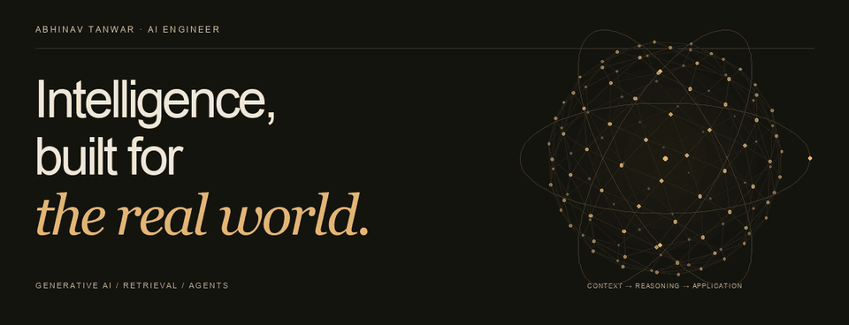
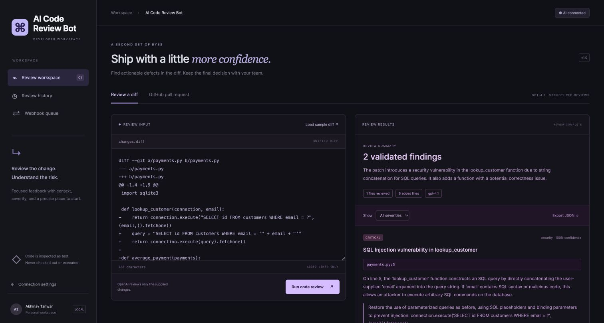
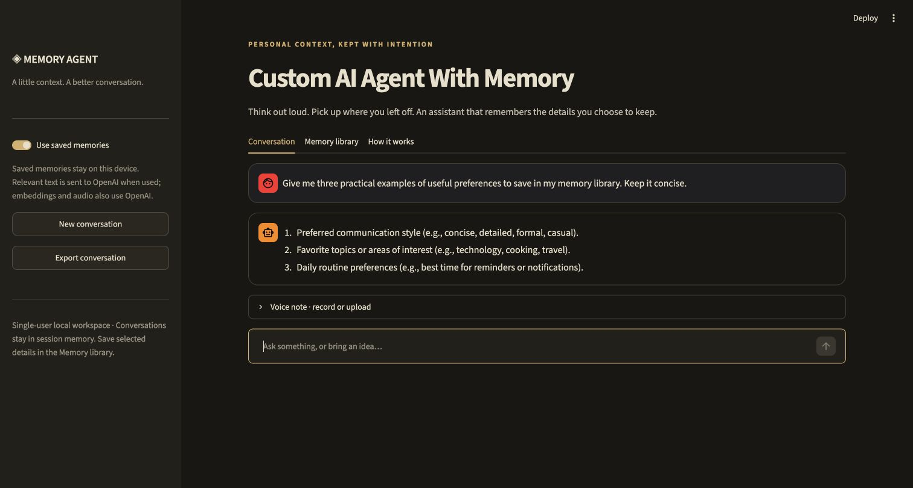

[**Portfolio ↗**](https://abhinav-tanwar.github.io/) &nbsp; · &nbsp; [LinkedIn ↗](https://www.linkedin.com/in/abhinav-tanwar-155ab8239/) &nbsp; · &nbsp; [Email ↗](mailto:abhinav.t@careeritjob.com)

I build **LLM-powered applications and production ML systems**—from retrieval and agent workflows to API deployment, monitoring, and evaluation.

### 01 / Selected work

| Project | Verified results | Evidence |
| :--- | :--- | :--- |
| [**AI Document Search ↗**](https://github.com/Abhinav-tanwar/AI-Document-Search-RAG-Chatbot) | **16 tests** · A live synthetic-PDF check returned the correct budget with a **page 2 citation**. | [Validation ↗](https://github.com/Abhinav-tanwar/AI-Document-Search-RAG-Chatbot/blob/main/VALIDATION.md) |
| [**AI Code Review Bot ↗**](https://github.com/Abhinav-tanwar/AI-Code-Review-Bot) | **22 tests** · **2 seeded defects** surfaced in a live review; a separate Actions run posted an inline PR comment. | [Validation ↗](https://github.com/Abhinav-tanwar/AI-Code-Review-Bot/blob/main/VALIDATION.md) · [Live PR review ↗](https://github.com/Abhinav-tanwar/AI-Code-Review-Bot/pull/1#discussion_r4331760004) |
| [**AI Agent With Memory ↗**](https://github.com/Abhinav-tanwar/Custom-AI-Agent-With-Memory) | **17 tests** · Save → reopen → recall → delete verified; live Whisper transcription checked. | [Validation ↗](https://github.com/Abhinav-tanwar/Custom-AI-Agent-With-Memory/blob/main/VALIDATION.md) |
| [**Permit Valuation Assistant ↗**](https://github.com/Abhinav-tanwar/permit-valuation-assistant) | **0.780 holdout R²** on a capped **log1p target** · **1,500 held-out records**. | [Model metrics ↗](https://github.com/Abhinav-tanwar/permit-valuation-assistant/blob/main/artifacts/model_metrics.json) |

Tests use deterministic doubles; live AI checks use synthetic examples and are not accuracy benchmarks. Permit R² is on the log target, not dollar accuracy; capped-target dollar MAE is $178,907. [Methodology ↗](https://github.com/Abhinav-tanwar/permit-valuation-assistant/blob/main/docs/methodology.md)

<strong>View the applications · four real screenshots</strong>

 
<table>
<tr>
<td width="50%" valign="top">
<strong>Document search</strong>  
 
Actual local PDF-library and chat workspace.
</td>
<td width="50%" valign="top">
<strong>Code review</strong>  
 
Live model output on a synthetic payment diff.
</td>
</tr>
<tr>
<td width="50%" valign="top">
<strong>Agent with memory</strong>  
 
Actual local chat, voice input, and memory controls.
</td>
<td width="50%" valign="top">
<strong>Permit valuation</strong>  
 
One example estimate—not an accuracy measurement.
</td>
</tr>
</table>

Click a screenshot to inspect it at full size. [Explore results and methods in the portfolio ↗](https://abhinav-tanwar.github.io/#work)

[Browse the complete repository collection →](https://github.com/Abhinav-tanwar?tab=repositories)

### 02 / Experience

**AI/ML Engineer · Citigroup** &nbsp; May 2026–Present  
Policy retrieval with LangChain, Amazon Bedrock, and pgvector; LangGraph workflows with analyst approval; FastAPI delivery and model monitoring.

**Machine Learning Engineer · Zomato** &nbsp; July 2021–March 2024  
Delivery prediction, late-order risk, and learning-to-rank systems using Python, XGBoost, FastAPI, PySpark, Airflow, and Redis.

### 03 / Working toolkit

**AI & retrieval** — LangChain · LangGraph · RAG · Embeddings · pgvector · LLM & retrieval evaluation  
**Production & cloud** — Python · FastAPI · Docker · AWS Bedrock & SageMaker · MLflow · pytest · CI/CD  
**ML & data** — SQL · scikit-learn · XGBoost · PySpark · Airflow · Redis · A/B testing

---

M.S. Applied Statistics and Data Science, **UT Arlington** — expected December 2026. B.E. Computer Science, Bangalore Institute of Technology.  
Vice President, Graduate Student Council, UTA · Spring 2026. [Published statistical research ↗](https://ijisr.issr-journals.org/abstract.php?article=IJISR-25-247-06).

**Interested in AI engineering opportunities.** [Get in touch →](mailto:abhinav.t@careeritjob.com)

