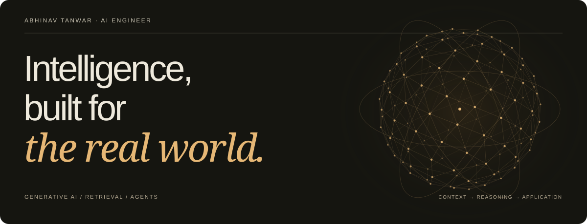

[**Portfolio ↗**](https://abhinav-tanwar.github.io/) &nbsp; · &nbsp; [LinkedIn ↗](https://www.linkedin.com/in/abhinav-tanwar-155ab8239/) &nbsp; · &nbsp; [Email ↗](mailto:abhinav.t@careeritjob.com)

I build **LLM-powered applications and production ML systems**—from retrieval and agent workflows to API deployment, monitoring, and evaluation.

### 01 / Selected work

| Project | From idea to application |
| :--- | :--- |
| [**AI Document Search (RAG Chatbot) ↗**](https://github.com/Abhinav-tanwar/AI-Document-Search-RAG-Chatbot) | PDF conversations grounded in retrieved source passages.   OpenAI · LangChain · FastAPI · FAISS |
| [**AI Code Review Bot ↗**](https://github.com/Abhinav-tanwar/AI-Code-Review-Bot) | GitHub PR feedback with validated inline findings and review history.   OpenAI · FastAPI · GitHub Actions |
| [**Custom AI Agent With Memory ↗**](https://github.com/Abhinav-tanwar/Custom-AI-Agent-With-Memory) | Voice and text conversations with explicit, inspectable long-term memory.   LangChain · Whisper · ChromaDB · Streamlit |
| [**Permit Valuation Assistant ↗**](https://github.com/Abhinav-tanwar/permit-valuation-assistant) | Saved regression pipeline with validated inputs and documented evaluation.   Python · scikit-learn · Streamlit |

[Browse the complete repository collection →](https://github.com/Abhinav-tanwar?tab=repositories)

### 02 / Experience

**AI/ML Engineer · Citigroup** &nbsp; May 2026–Present  
Policy retrieval with LangChain, Amazon Bedrock, and pgvector; LangGraph workflows with analyst approval; FastAPI delivery and model monitoring.

**Machine Learning Engineer · Zomato** &nbsp; July 2021–March 2024  
Delivery prediction, late-order risk, and learning-to-rank systems using Python, XGBoost, FastAPI, PySpark, Airflow, and Redis.

### 03 / Working toolkit

**AI & retrieval** — LangChain · LangGraph · RAG · Embeddings · pgvector · LLM & retrieval evaluation  
**Production & cloud** — Python · FastAPI · Docker · AWS Bedrock & SageMaker · MLflow · pytest · CI/CD  
**ML & data** — SQL · scikit-learn · XGBoost · PySpark · Airflow · Redis · A/B testing

---

M.S. Applied Statistics and Data Science, **UT Arlington** — expected December 2026. B.E. Computer Science, Bangalore Institute of Technology.  
Vice President, Graduate Student Council, UTA · Spring 2026. [Published statistical research ↗](https://ijisr.issr-journals.org/abstract.php?article=IJISR-25-247-06).

**Interested in AI engineering opportunities.** [Get in touch →](mailto:abhinav.t@careeritjob.com)

